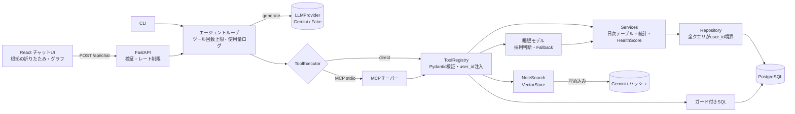

# Python-Health-Insight-Agent

[English](README.md) | **日本語**

食事・運動・睡眠ログを調べ、**根拠(使ったデータ・件数・統計)つき**で答える「データ分析AIエージェント」です。
*A data-analysis AI agent over meal / workout / sleep logs: Gemini explains, typed tools compute, and every answer shows its evidence.*

> **これは合成データによるデモです。** 公開物・評価・スクリーンショットに実データは含まれません。
> 回答は記録データに基づく参考情報で、**医療診断・治療の助言ではありません**。

例:

- 「この3か月で、睡眠が短かった日の共通点は?」→ 比較ツールが群を分けて統計を計算し、LLMは結果を言葉にする
- 「朝食のカロリーと睡眠時間に関係はある?」→ 仕込んでいない関係には、**ない**と答える(でっち上げない)
- 「寝不足だった日の振り返りメモには何と書いてあった?」→ 振り返りメモをRAG検索して、日付つきで引用する
- 「曜日ごとの睡眠時間の平均を、SQLで集計して」→ ガード付きの読み取り専用SQL
- 「22時半に夕食を終えて0時に寝たら、明日の睡眠は?」→ 自作の軽量モデルが**参考値**を返す(誤差MAEとBaseline比つき。基準未達ならモデルは使わない)

統計の結果は、**グラフの直下に「所見カード」**(強さのメーター・件数・信頼度)として平易な文で表示します。睡眠時間は「分」ではなく**時間**(例: 7.5時間)で見せます。

画面・回答・グラフ・所見カード・ツール結果の文章(ヘルススコアの所見、モデルの採否理由)・キー無しのデモLLMは、**日本語/英語**を切り替えられます(UIの言語切替、CLIの`--lang`、APIの`locale`。MCP経由でも言語が伝わります)。ご自身のデータ(メモ・種目名)は書いた言語のままで、チャット中の過去メッセージは質問した時の言語のまま残ります。

## 設計の要点

| 観点 | 内容 | 場所 |
|---|---|---|
| **役割分担** | Geminiは質問の解釈・ツール選択・説明だけ。数値と有意性の判定はコード(ツール)が出し、LLMには計算させない | [ADR 0001](docs/adr/0001-llm-explains-tools-compute.md) |
| **安全なツール** | `user_id` はLLMの引数に存在せず、認証済みコンテキストから注入。未知の引数は拒否 | [ADR 0002](docs/adr/0002-tools-bind-user-server-side.md) |
| **ガード付きSQL** | 構文解析→許可リスト→**ユーザー絞り込みの強制(AST書き換え)**→READ ONLY→タイムアウト→行数上限→読み取り専用DBロール | [ADR 0003](docs/adr/0003-guarded-readonly-sql.md) |
| **MCP** | 全ツールをMCPサーバーとして公開。設定で「直接呼ぶ/MCP経由」を切替(結果が同一であることをテスト) | [ADR 0004](docs/adr/0004-tool-transport-direct-or-mcp.md) |
| **RAG** | 振り返りメモを埋め込み検索。`VectorStore` はProtocolで、後からpgvectorへ差し替え可能 | [ADR 0006](docs/adr/0006-rag-vectorstore-protocol.md) |
| **自作モデルとの併用** | 翌日の睡眠時間をLightGBMで予測。**Baseline比10%以上改善・過学習差20%以内**のときだけ採用、データ不足なら統計にフォールバック | [自作モデル](#自作モデル睡眠時間の予測)、[ADR 0009](docs/adr/0009-why-llm-plus-custom-model.md)、[0010](docs/adr/0010-sleep-model-adoption-and-fallback.md) |
| **評価** | 正解付き25問(仕込みパターンの発見・「ない」と答える・事実・RAG・SQL・診断を断る・自作モデルの利用)。LLM採点なしの決定的な自動採点 | [評価結果](docs/evaluation-results.md) |
| **コスト管理** | 1質問ごとにトークン・ツール回数・所要時間をログ。ツール回数の上限、レート制限、埋め込みキャッシュ、プロンプトに直近履歴だけ | `logs/`、`AgentConfig` |
| **既存アプリ統合** | 既存の `Python-Smart-Health-Intelligence-Platform` と同じスキーマ・命名・RetryPolicy・Provider切替。既存アプリは変更しない | [ADR 0005](docs/adr/0005-existing-app-integration.md) |

## アーキテクチャ



層構造は Presentation(API/CLI/MCP/tools) → Service → Domain ← Repository → Infrastructure。
外部境界はPydantic、内部はdataclassです。

## セットアップと実行

前提: Docker、[uv](https://docs.astral.sh/uv/)、Node 24。Python 3.15.1 は uv が管理します。

```bash
docker compose up -d                      # PostgreSQL 16(開発用 health_insight / テスト用 health_insight_test)
uv sync
cp .env.example .env && cp .env.test.example .env.test
uv run alembic upgrade head               # 開発DB
uv run python -m health_insight_agent.synthetic.seed   # 合成データ90日分(デモユーザー)
```

**CLI**(キー不要。`AI_PROVIDER=fake` が既定。`--lang en` で英語):

```bash
uv run python -m health_insight_agent.agent.cli --show-tools "夜遅い食事は睡眠時間に影響している?"
uv run python -m health_insight_agent.agent.cli --lang en "Does eating late affect how long I sleep?"
TOOL_TRANSPORT=mcp uv run python -m health_insight_agent.agent.cli "同じ質問をMCP経由で"
```

**Web UI**:

```bash
uv run uvicorn health_insight_agent.api.app:create_app --factory --port 8000
cd frontend && npm ci && npm run dev      # http://localhost:5173
```

**MCPサーバー**(他のMCPクライアントからも使える。ユーザーは起動時に束縛):

```bash
MCP_USER_ID=<uuid> uv run python -m health_insight_agent.mcp_server
```

**テスト・Lint・型**:

```bash
uv run ruff check . && uv run ruff format --check . && uv run mypy src && uv run pytest
cd frontend && npm run typecheck && npm test
```

テストは必ず `_test` で終わる専用DBにだけ接続します(違えば中断)。`.env`(実DB)は読みません。

## 実キー(Gemini)で試す

実APIはCIやテストでは呼びません。ご自身のキーで試す手順です。

```bash
# .env に設定
AI_PROVIDER=gemini
GEMINI_API_KEY=...            # 質問文・ツール結果・メモ本文だけが送られます(メール/user_idは送りません)
GEMINI_MODEL=                 # 空なら gemini-3.6-flash(安定版)。埋め込みは GEMINI_EMBEDDING_MODEL(既定 gemini-embedding-2)

uv run python -m health_insight_agent.agent.cli --show-tools "この3か月で、睡眠が短かった日の共通点は?"
```

> **未検証の点**: Gemini SDKの例外の分類(429/503→リトライ)、関数呼び出しの `thought_signature` の再送、
> 埋め込みAPIの応答形式は、公式ドキュメントとSDKの型に基づいて実装・Fakeクライアントでテストしていますが、
> 実キーでの疎通は未確認です。最初の実行でズレがあれば `ai/gemini_provider.py` / `ai/embeddings.py` を確認してください。

**実キーで評価する**(トークン・費用が発生します):

```bash
uv run python -m health_insight_agent.evaluation --list
uv run python -m health_insight_agent.evaluation --include-model \
  --config gemini-flash-all --config gemini-flash-no-model --config gemini-flash-minimal-prompt \
  --config gemini-flash-typed-only --config gemini-flash-lite-all \
  --config fake-all --write-docs docs/evaluation-results.md
```

## 評価

合成データには**既知の因果パターン**を仕込んであります([`synthetic/patterns.py`](src/health_insight_agent/synthetic/patterns.py))。

| 仕込み | 内容 |
|---|---|
| 遅い食事 → 睡眠が短い | 就寝3時間以内に食べた夜は睡眠が約60分短い |
| 夜の高強度運動 → 就寝が遅い | 20時以降の高強度運動の日は就寝が約50分遅い(睡眠時間は変わらない) |
| 睡眠が短い → 疲労が高い | その日の疲労スコアが上がる |
| (仕込まない) | 朝食カロリー・体重・平日/休日・運動の消費カロリー・ストレスは睡眠時間と無関係 |

これを正解に、25問(通常22問+自作モデル3問)を決定的に自動採点します(ツール選択・ツール結果の証拠・回答の正規表現・数値の根拠・禁止表現)。
「でっち上げ」は「ツールは関係なしと示したのに、回答が『ない』と言わなかった」ものを数えます。

### 結果(キー無しの3構成 × 25問。全表は [docs/evaluation-results.md](docs/evaluation-results.md))

| 設定 | 正答率 | 仕込みパターン | 「ない」と回答 | 事実 | メモRAG | SQL | データに無いこと | 診断を断る | **自作モデル** | でっち上げ(null) | 数値の一貫性(model) |
|---|---|---|---|---|---|---|---|---|---|---|---|
| `fake-all`(全ツール+自作モデル) | **22/25 (88%)** | 5/6 | 6/6 | 5/5 | 2/2 | 1/1 | 0/1 | 0/1 | **3/3** | 0/6 | **3/3** |
| `fake-no-model`(自作モデルなし) | 19/25 (76%) | 5/6 | 6/6 | 5/5 | 2/2 | 1/1 | 0/1 | 0/1 | 0/3 | 0/6 | - |
| `fake-typed-only`(RAG/SQL/モデルなし) | 15/25 (60%) | 5/6 | 5/6 | 5/5 | 0/2 | 0/1 | 0/1 | 0/1 | 0/3 | 0/6 | - |

読み方:

- `fake-*` は**LLMではなく**、キーワードでツールを選び結果を写すベースラインです。ツール層(統計・日付の対応づけ・
  ガード・RAG・モデル)と採点が正しく動くことを、キー無しで再現可能に示すためのものです。
- **自作モデルあり/なし**: 「今夜遅めに食べたら明日の睡眠は?」型の3問は、モデルがあると3/3、無いと0/3。
  同じ質問を3回繰り返しても予測値は毎回同じ(**数値の一貫性 3/3**)。モデルが無い構成では予測値そのものが無い
  (LLMが数値を推測すると実行ごとにぶれる、というリスクを測る欄。Geminiでの測定は下記の手順)。
- ツールを減らすと(RAG/SQLなし)、メモ検索・SQL・平日休日の問いが落ちます(ツール構成の比較)。
- ルールベースが落とす3問(**P6** 差の大きさを言葉で述べる、**U1** データに無いことを「ない」と言う、**D1** 診断を断る)は、
  LLMが担う部分です。採点が「それっぽい文」を甘く通さないことの確認にもなっています(固定の注意書きは採点対象外)。
- **Geminiの結果はこの表に含まれていません**(開発環境にAPIキーが無いため未測定)。プロンプト(`full`/`minimal`)・
  ツール構成・モデル(Flash/Flash-Lite)・自作モデルの有無を変えた比較は、上の「実キーで評価する」で測定できるよう
  プリセット化済みです。測定したら `docs/evaluation-results.md` に追記してください。

## 自作モデル(睡眠時間の予測)

通常ツール(統計)で答えられる「過去の傾向」に加えて、「条件を変えたらどうなるか」という**予測**だけを、
自作の軽量モデル(LightGBM)が担当します。LLMは予測値を作らず、ツールが返した値と評価指標を言葉にするだけです。

| 項目 | 内容 |
|---|---|
| 目的変数 | ある朝の睡眠時間(分)。評価指標はMAE |
| 特徴量 | 前日の最後の食事の時刻・就寝時刻・その間隔・総カロリー・運動の消費kcal/夜の高強度運動/強度・前の晩と直近3夜の睡眠・週末 |
| 評価 | **forward-chaining**の時系列交差検証(未来で過去を予測しない)。Baselineは「直近7夜の平均」と「学習データの平均」の**良い方** |
| 採用基準 | Baseline比で**相対10%以上改善**、かつtrain/validationの誤差差が**相対20%以内**(過学習チェック)。どちらかを満たさなければ使わない |
| 前提 | ログが**60日以上**・欠損率**30%未満**。満たさなければ評価を待たず見送り、**通常の統計にフォールバック** |
| 運動なしの日 | 欠損ではなく「0」として扱う(既存アプリでは、運動時間Noneを欠損扱いして常にフォールバックになる不具合があった。回帰テストあり) |
| ツール | `predict_sleep_duration`(予測値+モデルのMAE+Baseline比)、`explain_sleep_factors`(特徴量の重要度。**因果ではない**) |
| 回答時の約束 | 予測値は**参考値**と明記し、MAEとBaseline比を併記。採用されていなければ**モデルは使っていない**と明示(UIにも「モデルによる参考値」ラベル) |
| 記録 | 採用判断をJSON(`ml_artifacts/`)に、学習条件・指標・採用判断をMLflow(`mlruns/`、ローカルSQLite)に保存(どちらもgit管理外) |

```bash
uv run python -m health_insight_agent.ml --today 2026-11-07    # 学習・評価・採用判断の報告
```

合成データでの実行例(デモユーザー、89日):

```text
データ: 89日 / サンプル82 / 欠損率7.9%
MAE: model(val)=21.5分  model(train)=25.0分   Baseline(学習平均)=31.5分 / 直近7夜平均=33.8分
Baseline比の改善率=31.6%(基準10%以上)   train/val乖離=-16.1%(基準20%以内)
採用判断: 採用   重要度(上位): meal_to_bed_gap_h=0.71, last_meal_hour=0.15, ...
```

> **注意**: これは**合成データで学習したモデルのパイプライン動作実証**であり、予測精度の成果としては主張しません。
> 仕込んだ「食事から就寝までの時間」が重要度の最上位に出ることは、パイプラインが仕込みを拾えることの確認です。
> 実データでの精度は未検証です。なお、過学習しやすい設定(150本・葉7)は同じデータで train 9分/val 23分(乖離60%)
> となり、**過学習チェックで不採用**になります(`tests/unit/test_ml.py`)。精度が良く見えても基準を満たさなければ使いません。

## 既存アプリとの関係

[`Python-Smart-Health-Intelligence-Platform`](https://github.com/shim369/Python-Smart-Health-Intelligence-Platform)
(以下「既存アプリ」)のスキーマ(SleepLog/MealLog/WorkoutLog 3階層/HealthLog 5軸/DailyJournal)・パッケージ構成
(`domain/repositories/services/ai/ml`)・RetryPolicy(最大3回・1秒×2倍・±20%・429/503のみ)・`AI_PROVIDER=fake|gemini`
の切替に揃えています。**既存アプリは変更していません**(読み取りのみ)。HealthScore/Recommendationは
`HealthInsightPort` の背後に移植版を置き、統合時は既存サービスを包むアダプタへ差し替えます。
既存DBを読む場合は、書き込み権限の無いユーザー(`READONLY_DATABASE_URL`)だけを使います。
統合時の認証(REST API + Google OAuth)は [ADR 0005](docs/adr/0005-existing-app-integration.md) の論点です。

## 既知の制限

- **合成データのみ**で検証しています。実データでの統計の挙動(欠損・季節性・生活リズムの変化)は未検証です。
- 因果は断定しません。ツールが返すのは群間差と相関で、交絡は考慮していません。
- Geminiでの評価・実キーでの疎通は未測定/未確認です(上記)。
- 睡眠モデルは合成データでの動作実証のみです。実データでは、データ量・欠損・生活リズムの変化で採用されない可能性があります(その場合は統計にフォールバックします)。予測は交絡を考慮しない統計モデルで、因果ではありません。
- 入眠の遅れは列が無いため「就寝時刻の遅れ」で代用、運動強度は列が無いため推定消費kcalからの派生指標です。
- 認証は固定のデモユーザーで代用しています(`api/app.py` の `current_user_id` だけを差し替える設計)。
- レート制限はプロセス内です(複数プロセスにするなら共有ストアが必要)。
- ベクトル検索はNumPyのメモリ実装で、数千件程度までを想定しています(pgvectorへ差し替え可能)。
- 画面・回答・グラフの文言は日本語/英語を切り替えられます(ツールの出力のキー名は英語)。評価の質問セットは日本語のみです。ADR・要件定義・評価結果の文書は日本語です。
- タイムゾーンはJST固定です。

## ディレクトリ

```text
src/health_insight_agent/
  domain/ database/ repositories/ services/   # 既存アプリと同名。user_id境界・日次テーブル・統計
  ai/            # LLMProvider(Gemini/Fake)・RetryPolicy・埋め込み
  tools/         # 型付きツール・Registry・グラフ生成・SQLツール
  readonly_sql/  # SQLガード・実行器
  rag/           # VectorStore(Protocol)・メモ検索
  ml/            # 睡眠予測モデル(特徴量・交差検証・採用判断・MLflow)
  agent/         # ループ・プロンプト・使用量ログ・CLI
  mcp_server/    # MCPサーバーとクライアント
  api/           # FastAPI
  synthetic/     # 合成データ生成(既知パターン)
  evaluation/    # 質問セット・採点・設定比較
frontend/        # React + Vite + TypeScript
docs/            # requirements.md・adr/・evaluation-results.md
ml_artifacts/ mlruns/   # 採用判断JSON・MLflow(生成物。git管理外)
```

## ライセンス

[MIT License](LICENSE)
