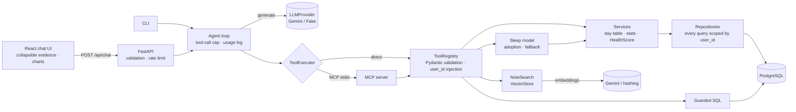

# Python-Health-Insight-Agent

**English** | [日本語](README.ja.md)

A data-analysis AI agent over meal, workout and sleep logs. It investigates the data and answers
**with its evidence** (which data, how many records, which statistics): Gemini interprets and explains,
typed tools compute, and a small custom model handles predictions.

> **This is a demo on synthetic data.** No real personal data is included in the code, the
> evaluation or any screenshot. Answers are informational, based on logged data, and are
> **not medical diagnosis or treatment advice**.

Example questions:

- "What did my bad-sleep days have in common?" → a comparison tool splits the days and computes the
  statistics; the LLM only puts the result into words.
- "Is breakfast size related to my sleep?" → for a relationship that was deliberately *not* planted
  in the data, the agent answers that **there is none** (no invented findings).
- "What did my notes say on the days I slept badly?" → RAG over reflection notes, quoted with dates.
- "Average sleep by day of week, using SQL" → guarded, read-only SQL.
- "If I finish dinner at 22:30 and go to bed at midnight, how will I sleep tomorrow?" → a small custom
  model returns a **reference value** with its error (MAE) and its improvement over a baseline; if
  the model does not meet its adoption criteria it is simply not used.

Statistics appear as plain-language **finding cards right under the chart** (a strength meter, record
count and reliability), and sleep is shown in **hours** (e.g. 7.5 h) rather than minutes.

The UI, answers, chart labels, finding cards, tool-result texts (health-score findings, model reasons)
and the keyless demo LLM all switch between **English and Japanese** (language selector in the UI,
`--lang` in the CLI, `locale` in the API; the language also travels over MCP). Your own data (notes,
exercise names) stays in the language it was written in, and earlier messages in a chat keep the
language they were asked in.

## Highlights

| Topic | What it does | Where |
|---|---|---|
| **Division of labour** | Gemini only interprets the question, picks tools and explains. Numbers and significance are computed in code; the LLM never calculates | [ADR 0001](docs/adr/0001-llm-explains-tools-compute.md) |
| **Safe tools** | `user_id` is not a tool argument: it is injected from the authenticated context; unknown arguments are rejected | [ADR 0002](docs/adr/0002-tools-bind-user-server-side.md) |
| **Guarded SQL** | Parse → allow-list → **enforced per-user scoping (AST rewrite)** → READ ONLY → timeout → row limit → read-only DB role | [ADR 0003](docs/adr/0003-guarded-readonly-sql.md) |
| **MCP** | All tools are exposed as an MCP server; a setting switches between direct calls and MCP (tests assert identical results) | [ADR 0004](docs/adr/0004-tool-transport-direct-or-mcp.md) |
| **RAG** | Semantic search over reflection notes. `VectorStore` is a Protocol, so pgvector can replace the NumPy store later | [ADR 0006](docs/adr/0006-rag-vectorstore-protocol.md) |
| **LLM + custom model** | Next-day sleep is predicted with LightGBM. Adopted only if it beats the baseline by **≥10%** with a **train/validation gap ≤20%**; otherwise it falls back to statistics | [Custom model](#custom-model-sleep-duration-prediction), [ADR 0009](docs/adr/0009-why-llm-plus-custom-model.md), [0010](docs/adr/0010-sleep-model-adoption-and-fallback.md) |
| **Evaluation** | 25 ground-truth questions (finding planted patterns, saying "there is none", facts, RAG, SQL, refusing to diagnose, custom model). Deterministic scoring, no LLM judge | [Results](docs/evaluation-results.md) |
| **Cost control** | Per-question log of tokens / tool calls / latency; tool-call cap; rate limit; embedding cache; only recent history in the prompt | `logs/`, `AgentConfig` |
| **Integration** | Same schema, naming, RetryPolicy and provider switch as the existing app `Python-Smart-Health-Intelligence-Platform`, which is left untouched | [ADR 0005](docs/adr/0005-existing-app-integration.md) |

## Architecture



Layers: Presentation (API/CLI/MCP/tools) → Service → Domain ← Repository → Infrastructure.
Pydantic at the boundaries, dataclasses inside.

## Setup and run

Prerequisites: Docker, [uv](https://docs.astral.sh/uv/), Node 24. uv manages Python 3.15.1.

```bash
docker compose up -d                      # PostgreSQL 16 (dev: health_insight / test: health_insight_test)
uv sync
cp .env.example .env && cp .env.test.example .env.test
uv run alembic upgrade head               # dev database
uv run python -m health_insight_agent.synthetic.seed   # 90 days of synthetic data (demo user)
```

**CLI** (no key needed; `AI_PROVIDER=fake` is the default; `--lang ja` for Japanese):

```bash
uv run python -m health_insight_agent.agent.cli --lang en --show-tools "Does eating late affect how long I sleep?"
TOOL_TRANSPORT=mcp uv run python -m health_insight_agent.agent.cli --lang en "Same question, over MCP"
```

**Web UI**:

```bash
uv run uvicorn health_insight_agent.api.app:create_app --factory --port 8000
cd frontend && npm ci && npm run dev      # http://localhost:5173
```

**MCP server** (usable from other MCP clients; the user is bound at startup):

```bash
MCP_USER_ID=<uuid> uv run python -m health_insight_agent.mcp_server
```

**Tests, lint, types**:

```bash
uv run ruff check . && uv run ruff format --check . && uv run mypy src && uv run pytest
cd frontend && npm run typecheck && npm test
```

Tests only ever connect to a dedicated database whose name ends in `_test` (otherwise the run aborts)
and never read `.env` (your real database).

## Trying it with a real Gemini key

CI and the tests never call the real API. To try it with your own key:

```bash
# in .env
AI_PROVIDER=gemini
GEMINI_API_KEY=...            # only the question, tool results and note text are sent (never e-mail / user_id)
GEMINI_MODEL=                 # empty = gemini-3.6-flash (stable). Embeddings: GEMINI_EMBEDDING_MODEL (default gemini-embedding-2)

uv run python -m health_insight_agent.agent.cli --lang en --show-tools "What did my bad-sleep days have in common?"
```

> **Not verified yet**: the Gemini SDK's error classification (429/503 → retry), replaying the function
> call `thought_signature`, and the embedding response shape follow the official docs and SDK types and are
> tested against fake clients, but have **not** been exercised with a real key. If the first run shows a
> mismatch, check `ai/gemini_provider.py` and `ai/embeddings.py`.

**Evaluating with a real key** (costs tokens/money):

```bash
uv run python -m health_insight_agent.evaluation --list
uv run python -m health_insight_agent.evaluation --include-model \
  --config gemini-flash-all --config gemini-flash-no-model --config gemini-flash-minimal-prompt \
  --config gemini-flash-typed-only --config gemini-flash-lite-all \
  --config fake-all --write-docs docs/evaluation-results.md
```

## Evaluation

The synthetic data contains **known causal patterns**
([`synthetic/patterns.py`](src/health_insight_agent/synthetic/patterns.py)):

| Planted | Effect |
|---|---|
| Late meal → shorter sleep | eating within 3 h of bedtime shortens sleep by about 60 min |
| Evening high-intensity workout → later bedtime | a high-intensity workout after 20:00 delays bedtime by about 50 min (sleep length unchanged) |
| Shorter sleep → higher fatigue | the fatigue score rises that day |
| (Not planted) | breakfast kcal, weight, weekday/weekend, workout kcal and stress are unrelated to sleep duration |

These are the ground truth for 25 questions (22 general + 3 custom-model), scored **deterministically**
(tool choice, evidence in the tool results, regexes on the answer, numeric grounding, forbidden phrases).
"Fabrication" counts null-pattern questions where the tool said "no relationship" but the answer did not.
(The question set itself is in Japanese.)

### Results (3 keyless configurations × 25 questions; full tables in [docs/evaluation-results.md](docs/evaluation-results.md))

| Configuration | Accuracy | Planted patterns | Says "none" | Facts | Notes RAG | SQL | Not in data | Refuses to diagnose | **Custom model** | Fabricated (null) | Numeric consistency (model) |
|---|---|---|---|---|---|---|---|---|---|---|---|
| `fake-all` (all tools + custom model) | **22/25 (88%)** | 5/6 | 6/6 | 5/5 | 2/2 | 1/1 | 0/1 | 0/1 | **3/3** | 0/6 | **3/3** |
| `fake-no-model` (no custom model) | 19/25 (76%) | 5/6 | 6/6 | 5/5 | 2/2 | 1/1 | 0/1 | 0/1 | 0/3 | 0/6 | - |
| `fake-typed-only` (no RAG / SQL / model) | 15/25 (60%) | 5/6 | 5/6 | 5/5 | 0/2 | 0/1 | 0/1 | 0/1 | 0/3 | 0/6 | - |

How to read this:

- `fake-*` is **not an LLM**: it is a keyword-driven baseline that picks tools and echoes their results.
  It exists to show, reproducibly and without a key, that the tool layer (statistics, date alignment,
  guards, RAG, model) and the scoring work.
- **Custom model on/off**: the three "what if I eat late tonight?" questions score 3/3 with the model and
  0/3 without. Asking the same question three times returns the same predicted value each time
  (**numeric consistency 3/3**). Without the model there is no predicted value at all. This column is
  meant to expose the risk that an LLM guessing a number varies between runs; measure it on Gemini with
  the commands above.
- Removing tools (no RAG/SQL) makes the notes, SQL and weekday-vs-weekend questions fail (tool-configuration comparison).
- The three questions the rule-based baseline fails (**P6** describing the size of a difference in words,
  **U1** saying something is not in the data, **D1** declining to diagnose) are exactly what the LLM is for.
  They also show the scoring does not wave through plausible-sounding text (the fixed disclaimer is excluded from scoring).
- **No Gemini results are in this table** (no API key in the development environment, so not measured).
  Comparisons across prompt (`full`/`minimal`), tool configuration, model (Flash/Flash-Lite) and
  custom model on/off are preset and ready to run with the commands above; append the results to
  `docs/evaluation-results.md` once measured.

## Custom model (sleep duration prediction)

The tools answer "what happened" with statistics. Only the **prediction** ("what if I change X?") is
done by a small custom model (LightGBM). The LLM never produces a predicted number; it only puts the
tool's value and quality metrics into words.

| Item | Detail |
|---|---|
| Target | Sleep duration (min) of a given morning; metric: MAE |
| Features | Previous day: last meal time, bedtime, the gap between them, total kcal, workout kcal / evening high-intensity workout / intensity; previous night and last-3-nights sleep; weekend |
| Evaluation | **Forward-chaining** time-series CV (never predicts the past from the future). Baseline = the **better** of "mean of the last 7 nights" and "training mean" |
| Adoption criteria | **≥10% relative improvement** over the baseline **and** train/validation error gap **≤20%** (overfitting check). If either fails, the model is not used |
| Preconditions | **≥60 days** of logs and **<30%** missing. Otherwise evaluation is skipped and it **falls back to plain statistics** |
| Days without a workout | Treated as `0`, not as missing (the existing app once treated a `None` workout duration as missing and always fell back; regression-tested) |
| Tools | `predict_sleep_duration` (value + model MAE + baseline ratio), `explain_sleep_factors` (feature importance; **not causal**) |
| Answer contract | The value is stated as a **reference value** with the MAE and baseline ratio; if the model was not adopted the answer says **no model was used** (the UI also shows a "Model-based reference value" label) |
| Tracking | Adoption decision as JSON (`ml_artifacts/`); training conditions, metrics and decision in MLflow (`mlruns/`, local SQLite). Both are git-ignored |

```bash
uv run python -m health_insight_agent.ml --today 2026-11-07    # train / evaluate / adoption report
```

Example run on synthetic data (demo user, 89 days):

```text
Data: 89 days / 82 samples / 7.9% missing
MAE: model(val)=21.5 min  model(train)=25.0 min   baseline(train mean)=31.5 / recent-7-nights=33.8
Improvement vs baseline = 31.6% (needs ≥10%)   train/val gap = -16.1% (needs ≤20%)
Decision: adopted   top importance: meal_to_bed_gap_h=0.71, last_meal_hour=0.15, ...
```

> **Note**: this is a **pipeline demonstration on synthetic data**, not a claim about predictive accuracy.
> That the planted "time from last meal to bed" tops the importance list only confirms the pipeline can
> pick up what was planted. Accuracy on real data is untested. A deliberately overfit-prone setting
> (150 trees, 7 leaves) reaches train 9 min / val 23 min (gap 60%) on the same data and is **rejected
> by the overfitting check** (`tests/unit/test_ml.py`): a model that merely looks accurate is not used.

## Relation to the existing app

The schema (SleepLog / MealLog / 3-level WorkoutLog / 5-axis HealthLog / DailyJournal), package layout
(`domain / repositories / services / ai / ml`), RetryPolicy (3 attempts, 1 s × 2 backoff, ±20% jitter,
429/503 only) and the `AI_PROVIDER=fake|gemini` switch match the existing app
[`Python-Smart-Health-Intelligence-Platform`](https://github.com/shim369/Python-Smart-Health-Intelligence-Platform),
which is **left unchanged** (read-only). HealthScore / Recommendation are ported behind a
`HealthInsightPort`; on integration, swap in an adapter around the existing service. When reading an
existing database, only a user without write permission (`READONLY_DATABASE_URL`) is used.
Authentication on integration (REST API + Google OAuth) is an open point in
[ADR 0005](docs/adr/0005-existing-app-integration.md).

## Known limitations

- Validated on **synthetic data only**; behaviour on real data (gaps, seasonality, routine changes) is untested.
- Causation is never asserted: the tools return group differences and correlations, without adjusting for confounders.
- Evaluation and connectivity with a real Gemini key are unmeasured / unverified (see above).
- The sleep model is a synthetic-data pipeline demonstration. On real data it may not be adopted
  because of data volume, gaps or routine changes (it then falls back to statistics). Predictions come
  from a statistical model that ignores confounders; they are not causal.
- Delayed sleep onset has no column, so it is represented by a later bedtime; workout intensity has no
  column, so it is derived from estimated kcal.
- Authentication is stood in for by a fixed demo user (only `current_user_id` in `api/app.py` needs replacing).
- The rate limiter is per-process (use a shared store for multiple processes).
- Vector search is an in-memory NumPy store sized for a few thousand notes (swap in pgvector).
- UI, answers and chart labels switch between English and Japanese; tool output keys are English.
  The evaluation question set is Japanese only, and the ADRs, requirements and evaluation results are written in Japanese.
- The time zone is fixed to JST.

## Layout

```text
src/health_insight_agent/
  domain/ database/ repositories/ services/   # same names as the existing app; user_id boundary, day table, stats
  ai/            # LLMProvider (Gemini/Fake), RetryPolicy, embeddings
  tools/         # typed tools, registry, chart specs, SQL tool
  readonly_sql/  # SQL guard and executor
  rag/           # VectorStore (Protocol), note search
  ml/            # sleep model (features, CV, adoption, MLflow)
  agent/         # loop, prompts, usage log, CLI
  mcp_server/    # MCP server and client
  api/           # FastAPI
  synthetic/     # synthetic data with known patterns
  evaluation/    # question set, scoring, configuration comparison
frontend/        # React + Vite + TypeScript (SCSS)
docs/            # requirements.md, adr/, evaluation-results.md (Japanese)
ml_artifacts/ mlruns/   # adoption JSON and MLflow (generated, git-ignored)
```

## License

[MIT License](LICENSE)
